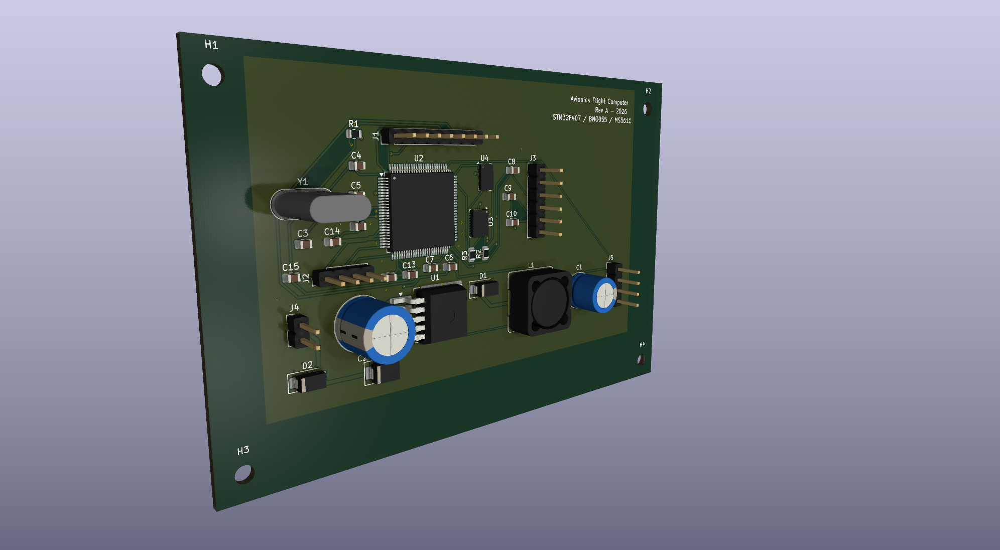
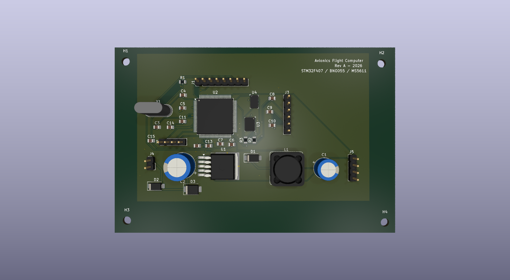
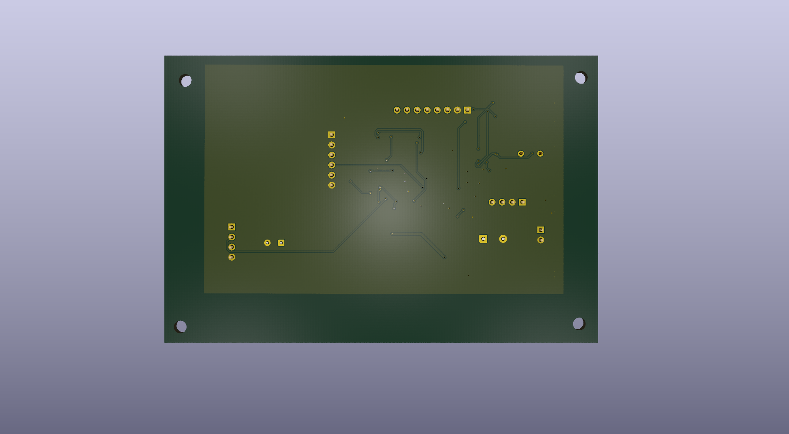

# Rocket Avionics Flight Computer PCB (STM32F407)

A custom 2-layer prototype Printed Circuit Board (PCB) designed in **KiCad** for competitive rocketry avionics and telemetry applications (TEKNOFEST Rocket Competition).

## Status

- Revision A, design complete
- ERC: 0 errors, 0 warnings
- DRC (including schematic parity check): 0 errors, 0 warnings
- Gerber and drill files generated (see `Avionics_Flight_Computer_gerber.zip`)
- Not yet fabricated or tested

## Overview

This board serves as the central flight computer and sensor hub, integrating onboard inertial and barometric sensors with dedicated hardware communication interfaces for external GPS, high-g accelerometer, and long-range wireless telemetry modules.

## Board at a Glance

| Item | Value |
|---|---|
| Size | 109.5 x 72.5 mm |
| Layers | 2 (F.Cu / B.Cu), solid GND copper pour on both sides |
| Thickness | 1.6 mm |
| Mounting | 4 x M3 holes (3.2 mm) near the corners |
| Design tool | KiCad 10.0 |

## Hardware Architecture & Key Components

- **Microcontroller:** STMicroelectronics **STM32F407VGTx** (ARM Cortex-M4, LQFP-100) with 8 MHz crystal, decoupling capacitors and VCAP network. BOOT0 is tied to GND (boots from flash).
- **Power Management:** power enters through J4.
  - **D2 (SS34):** reverse-polarity protection
  - **D3 (SMBJ15A):** TVS diode for voltage spikes
  - **C2 (100 uF / 35 V):** input capacitor
  - **LM2596S-3.3:** step-down regulator, with L1 (33 uH), Schottky catch diode D1 and output capacitor C1 (220 uF), providing a **3.3 V** rail.
  - The SMBJ15A has a 15 V standoff voltage, so the input must stay below 15 V. The design target is a 2S-3S LiPo class supply (about 7-12.6 V).
- **Onboard Sensors (I2C1 bus with 4.7 kOhm pull-ups):**
  - **BNO055:** 9-axis absolute orientation IMU (LGA-28), COM3 tied to GND (I2C address 0x28)
  - **MS5611-01BA:** barometric pressure and altitude sensor (LGA-8), CSB tied to GND (I2C address 0x77)
- **External Module Interfaces:**
  - **SPI1 Header (J1):** external high-g accelerometer (**H3LIS331DL**) or flash memory
  - **UART2 Header (J2):** **NEO-8M** GPS module
  - **UART3 Header (J3):** **E220-400T30D** LoRa wireless telemetry transceiver
- **Programming / Debug:** SWD header (J5). NRST has a 10 kOhm pull-up and a 100 nF capacitor.
- **PCB Layout:** 2-layer stack-up with dual-sided solid GND pours. The VIN / switch-node power path uses 0.6 mm traces; signal traces are 0.2-0.25 mm.

## Connector Pinout

| Connector | Pin 1 | Pin 2 | Pin 3 | Pin 4 | Pin 5 | Pin 6 | Pin 7 | Pin 8 |
|---|---|---|---|---|---|---|---|---|
| **J1** (SPI1) | 3.3V | GND | SPI1_SCK | SPI1_MOSI | SPI1_MISO | SPI1_CS | not connected | not connected |
| **J2** (UART2) | 3.3V | GND | UART2_RX | UART2_TX | | | | |
| **J3** (UART3) | GND | GND | UART3_TX | UART3_RX | 3.3V | GND | | |
| **J4** (power in) | VIN+ (via D2) | GND | | | | | | |
| **J5** (SWD) | 3.3V | SWDIO | SWCLK | GND | | | | |

UART directions are named from the STM32 side (UART2_TX is the MCU transmit line).

## MCU Pin Assignments

| Function | MCU pin |
|---|---|
| I2C1 SCL / SDA | PB6 / PB7 |
| SPI1 CS / SCK / MISO / MOSI | PA4 / PA5 / PA6 / PA7 |
| UART2 TX / RX | PA2 / PA3 |
| UART3 TX / RX | PB10 / PB11 |
| SWDIO / SWCLK | PA13 / PA14 |

## Renders

| Top | Bottom |
|---|---|
|  |  |

## Repository Contents

- `Avionics_Flight_Computer_PCB.kicad_pro` - KiCad project file
- `Avionics_Flight_Computer_PCB.kicad_sch` - complete circuit schematic
- `Avionics_Flight_Computer_PCB.kicad_pcb` - 2-layer PCB layout
- `Avionics_Flight_Computer_PCB.pdf` - schematic in PDF form
- `Avionics_Flight_Computer_gerber.zip` - Gerber and drill files for fabrication
- `pcb_top.png`, `pcb_bottom.png`, `pcb_angle.png` - 3D renders

## Known Limitations (ideas for the next revision)

1. Decoupling capacitors C9 and C10 sit about 8 mm from the sensor supply pins, and C14 and C15 are not directly next to the MCU supply pins. Placement was limited by routing density.
2. The BNO055 RESET and INT pins are not connected, so the IMU can only be reset by power cycling.
3. J1 has a single chip-select line (PA4), so an accelerometer and a flash chip cannot both be used on J1 at the same time.
4. J3 breaks out only UART, 3.3 V and GND. The E220 module's mode pins (M0/M1) and AUX are not connected to the MCU. Check the module's supply range and peak transmit current in its datasheet, since the board provides 3.3 V only.
5. The input capacitor C2 is 100 uF. The LM2596 datasheet's typical application uses a larger value, so it can be increased in a later revision.
